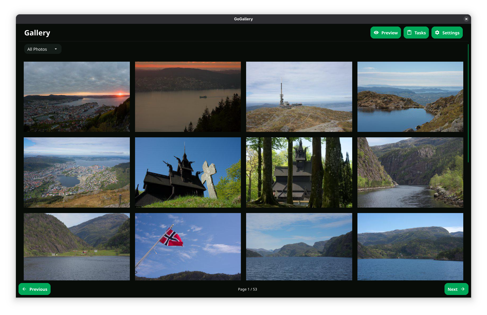
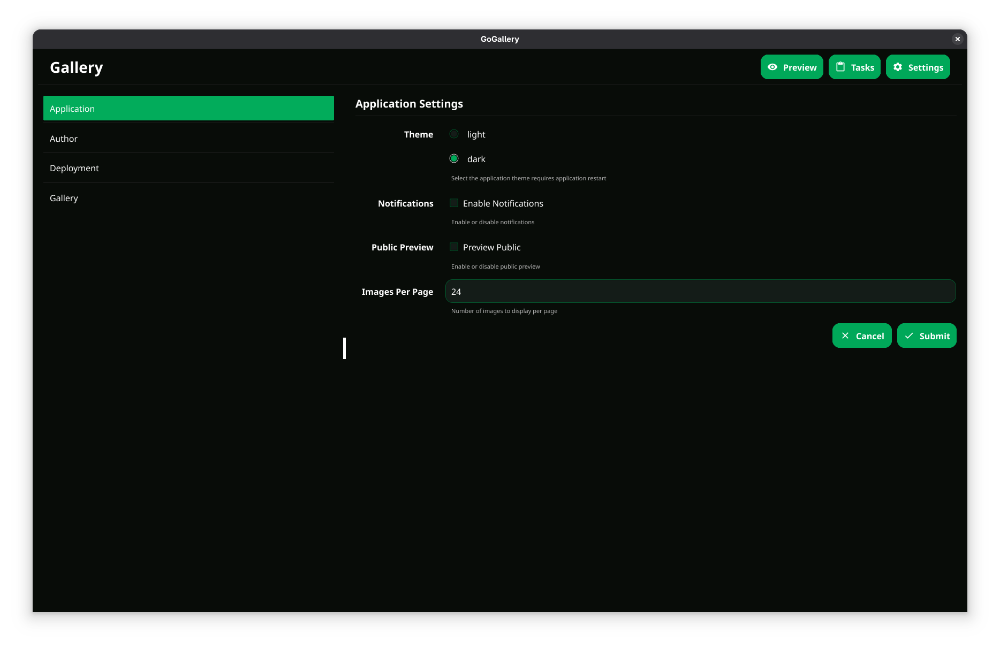
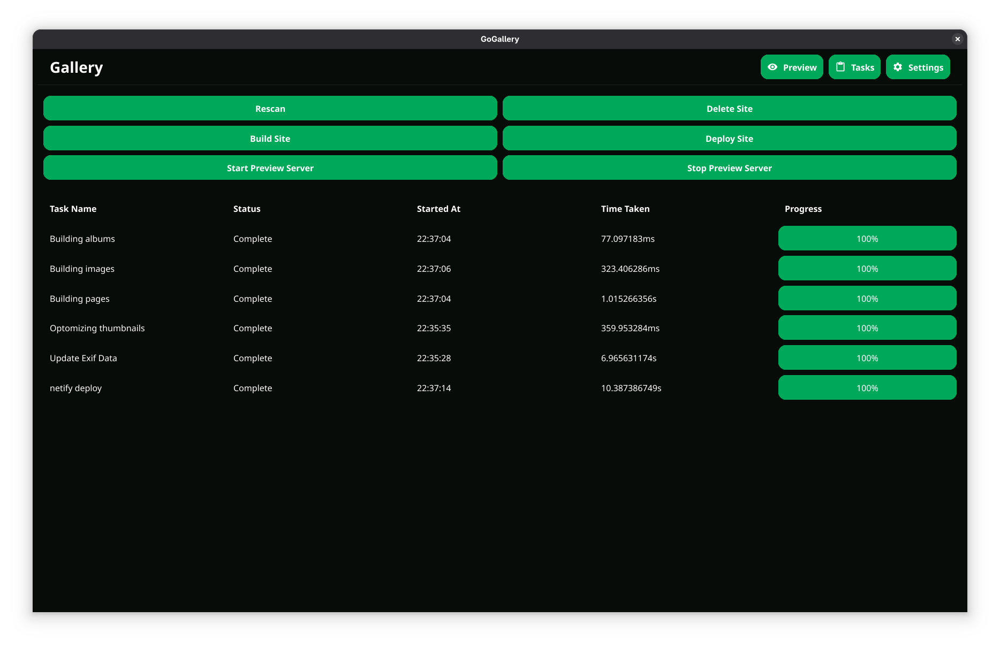
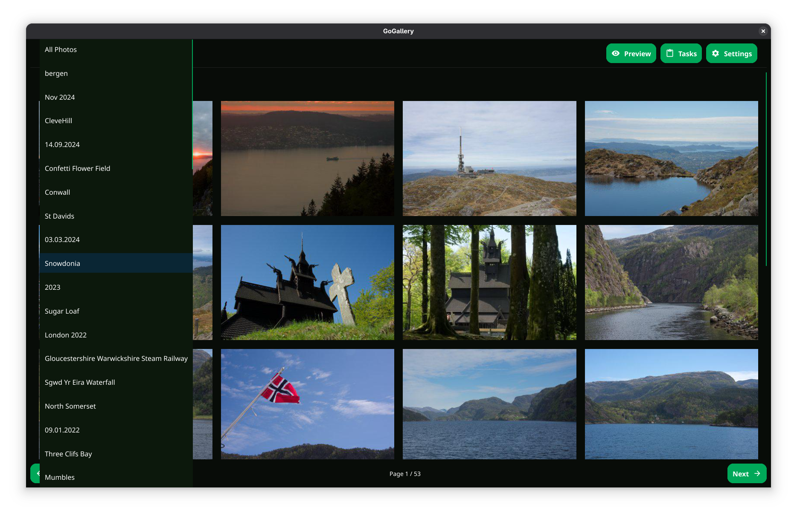
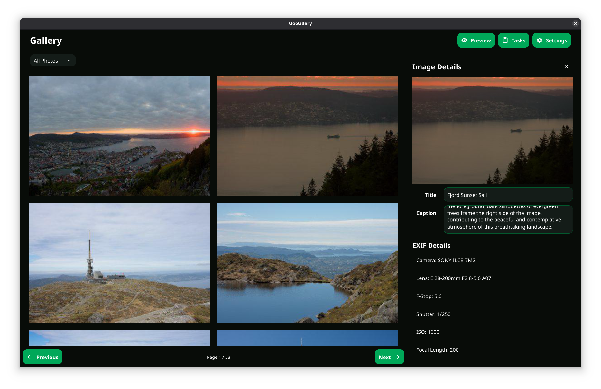
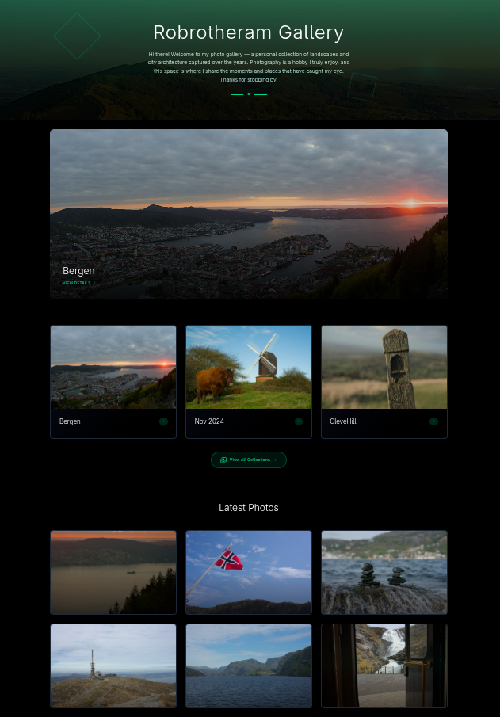
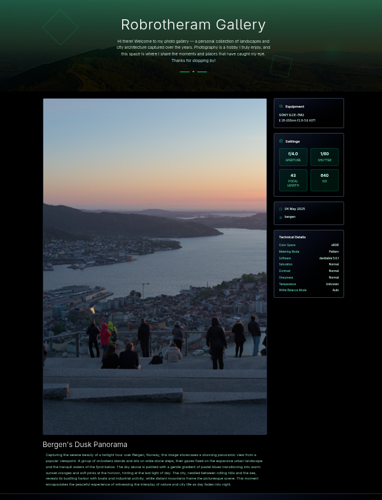
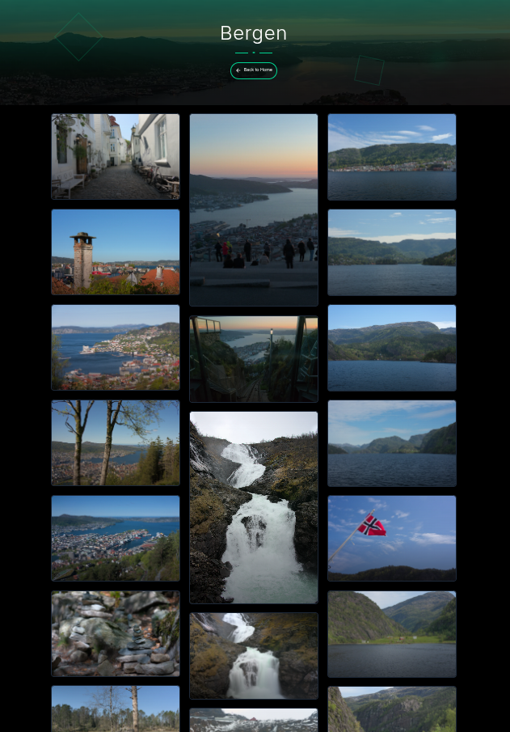

# GoGallery
***It's like Hugo, but for large photo galleries.***

GoGallery is a static site generator designed for large photo collections. A gallery of approximately 1,000 original images can easily reach 5 GB, making workflows that keep every asset in a Git repository impractical. GoGallery works with photos already organised in folders (albums), without requiring you to rearrange them around a separate content database.

Point GoGallery at your photos and it generates a static site with a customisable Go-template theme. It optimises images into multiple web-friendly sizes and generates a progressive web app that can be installed on desktop and mobile devices. The Fyne dashboard lets you edit titles, descriptions, tags, albums, and AI-generated photo metadata, as well as preview, build, and deploy the site.

WebP exports automatically scale oversized photos to fit within 16,383 pixels per side, preserving their aspect ratio. This also applies to the largest export size. Source photos and optional original-file downloads keep their original resolution.

The desktop dashboard lets you manage photo metadata, choose album covers, and control which albums and pictures are published. You can also preview the generated site with the `serve` command.

### Desktop library

- **Photos** shows your library with search and sorting. Hover over a photo to see its title. Select a photo to edit its details or website visibility. Double-click to open the photo viewer; use the arrow keys to browse and Escape to close it.
- **Albums** follows your folder hierarchy, with cards showing a cover and album title. Open an album to browse its subalbums and photos; use Back or the breadcrumb trail to navigate to a parent. Covers can come from nested albums, and search finds albums at any depth. Use **Album details** to rename it, or select a photo and choose **Use as album cover**. Titles and covers are preserved when scanning again.
- **Settings** groups library paths, author details, application preferences, and publishing credentials into tabs. Spacious form groups sit side by side on wide screens and stack in smaller windows, with aligned headings, folder choosers, and persistent save controls.
- **Tasks** provides a compact, responsive button grid for scanning the library, building the website, starting previews, and publishing to Netlify. Activity contains task messages, status badges, and progress percentages. Failed image exports report each source file's path and the reason it failed. **Maintenance options** reveals the generated-website cleanup controls.

The details panel becomes a full-width view in small windows. Closing it returns to the same photo grid.

AI suggestions are optional and disabled by default, including when an API key is already saved. Enable them under **Settings → Application → AI** and add a Gemini API key. Only when you request suggestions is the selected photo sent to Google Gemini to suggest a title, description, and tags. Review the text in the photo editor and save to apply it. AI never changes image files, or their appearance. Preview sharing has its own settings section.


## Usage

```
gogallery [flags]
```

### Options

```
      --config string   config file (default is $HOME/.gogallery.yaml)
  -h, --help            help for gogallery
```

### SEE ALSO

* [gogallery build](docs/cli/gogallery_build.md)	 - build static site
* [gogallery deploy](docs/cli/gogallery_deploy.md)	 - deploy static site
* [gogallery serve](docs/cli/gogallery_serve.md)	 - serve static site
* [gogallery template](docs/cli/gogallery_template.md)	 - extract template


---

## History

GoGallery was inspired by the parts of the Koken gallery CMS that I used most. It is not intended to be a full Koken replacement.

The application provides a cross-platform Fyne dashboard for managing photos and collections alongside its command-line tools.


## Demo


Demo: https://gallery.exceptionerror.io

## Screenshots

### Dashboard/App

| Dashboard Home | Settings | Tasks |
|----------------|----------|-------|
|  |  |  |

| Album View | Sidebar |
|------------|---------|
|  |  |

### Generated Website

| Website Home | Photo Page | Collection Page |
|--------------|------------|-----------------|
|  |  |  |


## Contributing

Pull requests are welcome. For major changes, please open an issue first to discuss what you would like to change.

Please make sure to update tests as appropriate.

## License

[apache-2.0](https://choosealicense.com/licenses/apache-2.0)


## Building GoGallery

You can build GoGallery from source using Go. Make sure you have Go 1.26 or newer installed.

### Standard Build (CLI and Web)

You can use the provided Makefile for building:

```bash
make build         # Build the GoGallery CLI/web binary
make build-themes  # Build all theme assets (npm install/build/clean in each theme)
make clean         # Remove built binaries
```
This will produce the `gogallery` binary in your current directory.

To build and install the binary to `/usr/local/bin`, run `make install`
(the destination must be writable). For a user-local installation:

```bash
make install PREFIX="$HOME/.local"
```

Ensure `$HOME/.local/bin` is on your `PATH`. You can override `BINDIR` to
choose another binary directory, or set `DESTDIR` to stage the installation
for packaging.

On Linux, `make install` also installs a desktop entry and the application icon
under `$(PREFIX)/share`, so **GoGallery** appears in application launchers such
as Omarchy's. The entry launches the desktop dashboard using the installed
binary's absolute path. Override `DATADIR` to choose another data directory.

Or, to build manually:

```bash
go build -o gogallery main.go
```

### Building the Fyne Desktop App

You can use the Makefile to build the Fyne desktop app and install dependencies:

```bash
make fyne-cli           # Install the Fyne CLI tool
make fyne-deps-ubuntu   # Install Fyne dependencies (Ubuntu)
make fyne-deps-fedora   # Install Fyne dependencies (Fedora/RedHat)
make fyne-build         # Build the Fyne desktop app for your platform
```

- The `fyne-build` target will auto-detect your OS and build the appropriate package.
- You can also run `make all` to install Fyne CLI and build the desktop app in one step.

> For more details, see the [Fyne packaging documentation](https://docs.fyne.io/started/packaging/) and the GoGallery wiki.

## Theme Development

See the [Theme Development Guide](themes/DEVELOPER_README.md) for instructions on building and customizing GoGallery templates and themes.
